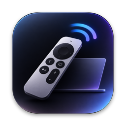
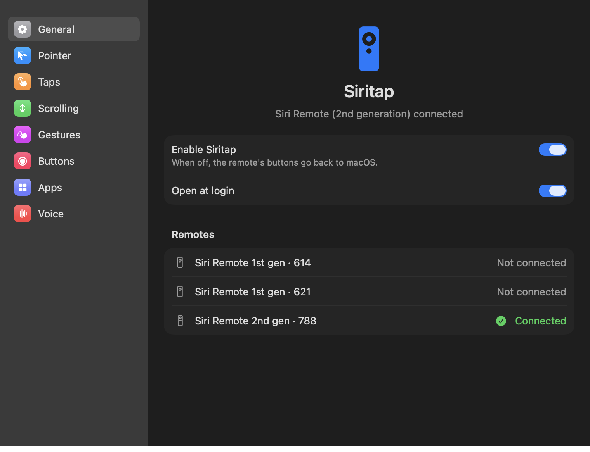
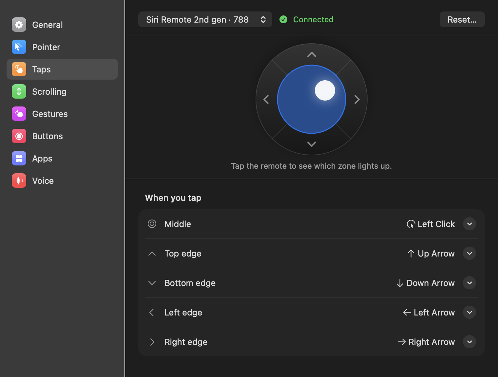
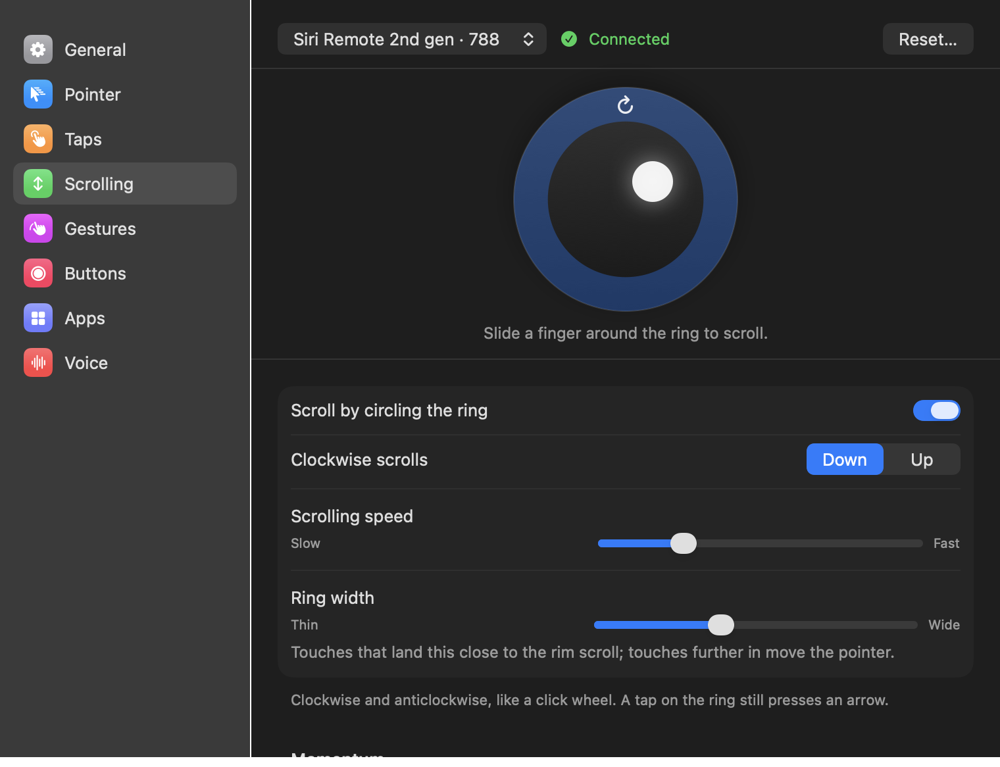
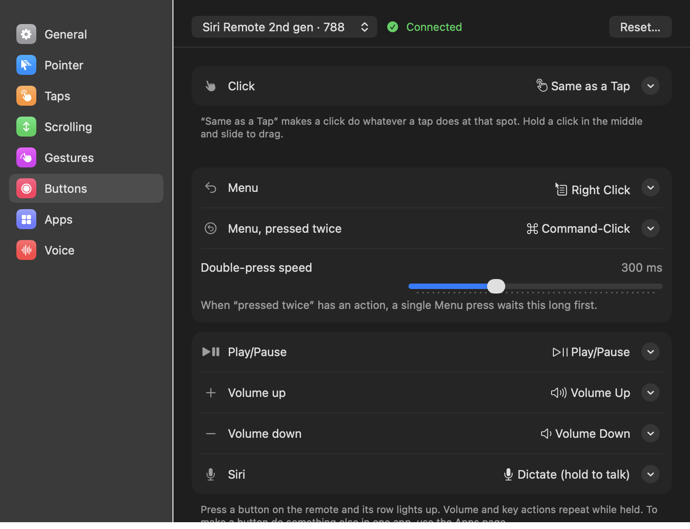
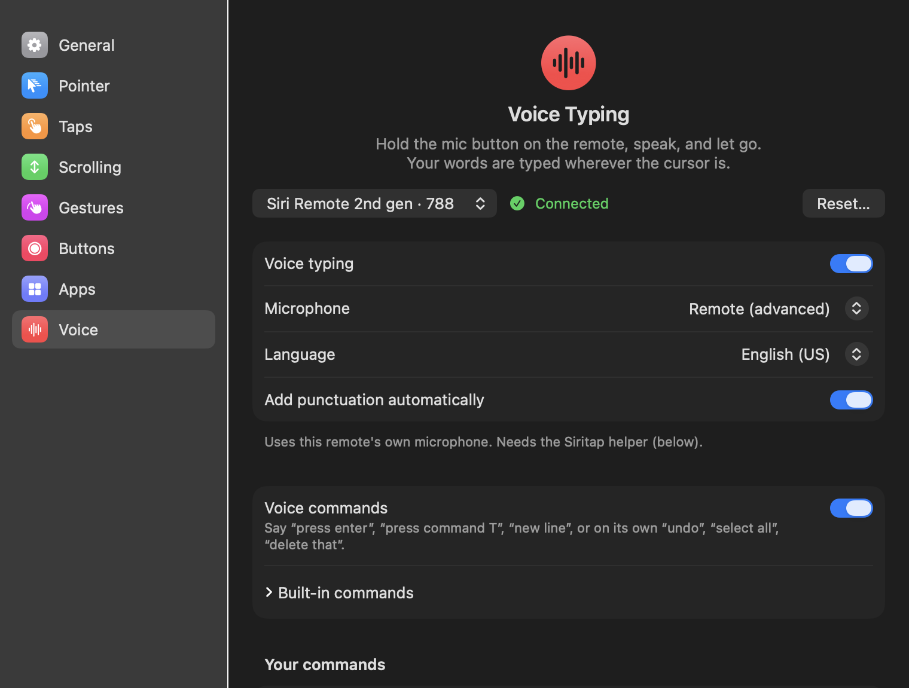

<h1 align="center">Siritap</h1>

Use an Apple TV Siri Remote as a trackpad, scroll wheel, media remote and voice keyboard for your Mac.

  <a href="../../releases/latest"><b>Download the latest release</b></a> ·
  <a href="https://siritap.leet.ae">siritap.leet.ae</a> ·
  macOS 14 or later · Apple silicon and Intel · Free

---

Siritap is a small menu-bar app. Pair a Siri Remote with your Mac, open Siritap, and the remote moves the pointer, taps, scrolls, switches desktops, controls media and types what you say. Every gesture and button can be changed, for each remote and for each app.

## Features

**Touch surface**
- Move the pointer like a trackpad, with adjustable speed and acceleration.
- Tap zones: a tap in the middle clicks, a tap on an edge presses an arrow key. Each zone can do anything you like.
- Click the remote without lifting your finger, and the click lands where you aimed: the pointer is put back to where it was before the press nudged it. Keep it held and slide to drag.
- Ignores light, accidental touches, and can hold the pointer still while you press hard.

**Button mode** *(new in 0.3)*
- The pointer settles on buttons, links, text fields, files and Dock icons, with a thin outline around the one in focus, like on Apple TV.
- Swipe straight across or up and down to step from one to the next. A longer swipe goes further, and a hard flick keeps going.
- Siritap reads your intent from the swipe: a diagonal movement moves the pointer instead, and so does pushing on past the last button in a window.
- Or switch it on and off yourself by holding the click, and swipe across the whole screen, from the Dock to the menu bar.
- Off by default. Choose Automatic or "Hold the click to switch" on the Pointer page.

**Scrolling**
- Scroll along the right edge, with momentum after a flick, like a trackpad.
- On the 2nd-generation remote, circle the ring to scroll like a click wheel. Scrolling starts the moment your finger touches the ring.

**Gestures**
- Double-tap, and tap-then-swipe left or right (switch desktops by default).

**Buttons**
- Remap Menu, Menu pressed twice, Play/Pause, Volume, Siri and the click.
- Actions include mouse clicks (left, right, middle, modifier-clicks), any key or shortcut, media keys, brightness, Mission Control, desktops, app windows, and running a shell command.
- Volume and keys repeat while held.

**Per-app rules**
- Give any app its own actions. VLC comes set up: the volume buttons change VLC's own volume while it's in front.

**Voice typing**
- Hold the Siri button, speak, let go: your words are typed wherever the cursor is.
- Uses the Mac's microphone with any remote, or the 2nd-generation remote's own microphone (see [Voice](#voice)).
- Recognised on your Mac by Apple's speech engine, with automatic punctuation and a choice of English variants.
- Voice commands: "press enter", "press command T", "new line", "new paragraph", "delete that", and on their own "undo", "select all", "copy", "paste", "new tab", and more. Add your own phrase for any action.

**Made for each remote**
- Every setting is kept separately for each remote, so a 1st-generation and a 2nd-generation remote can behave differently.
- A live view of the remote stays at the top of each page and shows your finger while you adjust the settings below it.

  
  
  
  

## Supported remotes

| Remote | Looks like | Touch | Edge-strip scroll | Ring scroll | Voice |
|---|---|---|---|---|---|
| Siri Remote, 1st generation (A1513, A1962) | Black, glass touch surface | Yes | Yes | – | Mac microphone |
| Siri Remote, 2nd generation (A2540) | Silver, clickpad with a touch ring | Yes | – (uses the ring) | Yes | Mac microphone, or the remote's own |

Other Siri Remote models may pair but haven't been tested yet. If yours isn't listed, please [open an issue](../../issues).

## Install

1. Download `Siritap-x.y.dmg` from [Releases](../../releases/latest), open it and drag **Siritap** into **Applications**.
2. Pair the remote in **System Settings → Bluetooth**:
   - 1st generation: hold **Menu + Volume Up** for about 5 seconds, close to the Mac.
   - 2nd generation: hold **Back + Volume Up** for about 5 seconds.
3. Open Siritap. It asks for **Accessibility** permission, which it needs to move the pointer and press keys. Turn Siritap on in **System Settings → Privacy & Security → Accessibility**.
4. Quit Remote Buddy, SiriMote or any other remote app. Only one app can drive the remote at a time.

Siritap lives in the menu bar. Click its remote icon for **Settings…**, or to turn it off and give the remote back to macOS.

## Voice

Set **Dictate (hold to talk)** on a button (the Siri button on the 2nd generation has it already), then hold it and speak.

**This Mac** (default): the button starts and stops listening, and the Mac's microphone or your headset hears you. Works with every remote and needs nothing extra. macOS asks for Microphone and Speech Recognition permission the first time.

**Remote (advanced, 2nd generation only)**: uses the microphone in the remote. macOS has no way for apps to receive that audio, so Siritap installs a small background helper (you approve it in **System Settings → General → Login Items**). While Siritap is open and the remote is connected, the helper turns on macOS's Bluetooth diagnostic logging, picks the remote's voice out of it, and turns the logging off again when you quit. It needs no Xcode, PacketLogger or configuration profile. Only the signed Siritap app can connect to the helper.

1st-generation remotes don't send their microphone audio to a Mac, so they use the Mac's microphone.

## How it compares

| | Siritap | Remote Buddy 2 | BetterTouchTool | SiriMote | Voxa |
|---|---|---|---|---|---|
| Price | Free | Paid | Paid | Free | Free, voice features paid |
| Touch-surface pointer | Yes | Yes | Yes | – | Yes |
| Tap zones and edge arrows | Yes | – | – | – | – |
| Focus on buttons, swipe between them | Yes | – | – | – | – |
| Momentum scrolling | Yes | – | – | – | – |
| Ring scrolling (2nd gen) | Yes | Yes | – | – | Paid |
| Per-app actions | Yes | Yes | Yes | A few apps | Yes |
| Voice typing | Free, any remote | – | – | – | Paid, some remotes |
| Voice commands | Yes, in English, plus your own | – | – | – | Chinese |
| Speech recognised | On your Mac | – | – | – | Partly online |
| Intel Macs | Yes | Yes | Yes | Yes | – |

This comparison was put together in November 2026 from each product's public pages; "–" means not offered or not documented. Corrections are welcome.

## Privacy

Siritap makes no network connections, collects nothing and has no analytics. Button mode reads the positions of buttons from other apps through macOS Accessibility, on your Mac only. Speech is recognised by macOS on your Mac whenever your language supports it; otherwise macOS may send it to Apple, as it does for dictation. Details in [PRIVACY.md](PRIVACY.md).

## Settings file

Settings are saved in `~/.config/siritap/config`, a plain text file you can back up or copy to another Mac. Voice settings are kept in the app's preferences.

## Uninstall

1. Click the menu-bar icon → **Quit Siritap**, then move **Siritap** from Applications to the Bin.
2. If you used the remote's microphone, turn off the Siritap helper in **System Settings → General → Login Items**.
3. Optionally delete `~/.config/siritap` and run `defaults delete ae.leet.siritap`.

## Troubleshooting

- **The remote does nothing.** Check that Siritap is ticked in Accessibility settings. After an update, macOS sometimes needs it switched off and on again.
- **The pointer moves but buttons behave like before.** Another remote app (such as Remote Buddy) is running; quit it.
- **Voice types the wrong words.** Pick your English variant on the Voice page, and speak after the listening window appears.
- **The remote disconnects.** Siri Remotes go to sleep after a few idle minutes; press any button to wake them.

## Feedback

Bug reports and ideas are welcome in [Issues](../../issues). Please mention your remote, your macOS version and your Mac.

---

Siritap isn't made by or affiliated with Apple. Apple TV and Siri are trademarks of Apple Inc.
